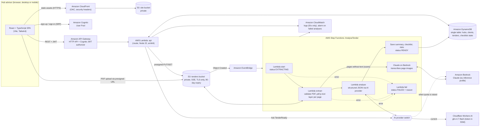

# TenderReady AI: Architecture

TenderReady AI is a digital compliance officer for **SMME hubs, incubators and business support centres**. A hub advisor manages many SMME clients. For each client, the advisor uploads tender or RFQ PDFs and gets back a plain-language summary, a compliance checklist, a list of disqualification risks and document-grounded Q&A. Everything is deployed as a single AWS CDK stack (`infra/`) in **eu-north-1 (Stockholm)**. The hackathon AWS organisation only permits that region. Amazon Textract is not offered in eu-north-1, so text extraction runs inside Lambda: digital pages are read from the PDF text layer with pdf.js, and scanned pages are transcribed by Claude on Bedrock.

> **Current AI backend: Cloudflare Workers AI (`@cf/zai-org/glm-4.7-flash`).** The hackathon account's Amazon Bedrock quota is 0 tokens per day for every model, so the Lambdas call Workers AI's OpenAI-compatible REST API instead. The token is stored in AWS SSM Parameter Store. The code has a provider switch (`aiProvider` in `infra/cdk.json`), so moving back to Bedrock once the quota is raised is a one-line change. Everything else stays on AWS. In Workers AI mode, scanned PDFs are not supported; text-based PDFs are.

## Request flows

1. **Sign in.** The SPA authenticates against Cognito using the Amplify Auth library (SRP). The advisor's Cognito `sub` is their **hub id**.
2. **Manage clients.** `GET/POST/PUT/DELETE /clients`. All records sit under the partition key `HUB#`, which is taken from the verified JWT and never from user input.
3. **Upload a tender.**
   - `POST /clients/{id}/tenders` creates a tender record with status `UPLOADING`.
   - It returns a 5-minute presigned S3 PUT URL. The URL is locked to `application/pdf` and to the exact byte size, with a 20 MB maximum.
   - The browser uploads the file straight to S3, so the file never passes through Lambda.
4. **Pipeline.** The S3 `Object Created` event goes through EventBridge to Step Functions. Each step updates the tender's `status`, and the UI polls `GET /tenders/{id}` every 3 seconds to drive the progress stepper.
5. **Review.** The summary, checklist and risks are read from DynamoDB. Ticking checklist items calls `PATCH /tenders/{id}/checklist/{itemId}`, which uses optimistic concurrency.
6. **Ask TenderReady.**
   - `POST /tenders/{id}/ask` loads the page-tagged text from S3 and calls Bedrock Converse. The document sits in a cached system block.
   - The model must answer only from the document and cite `[p.N]`. Citations are parsed and checked against real page numbers.
7. **Compliance pack.** A print-optimised page that the advisor saves as PDF and hands to the SMME. This is the "force multiplier" output.

## AWS services and why

| Service | Role | Why it fits |
|---|---|---|
| Amazon S3 | Private storage for tender PDFs and extracted text; hosting for the SPA | Cheap, durable and encrypted. Presigned URLs keep uploads off Lambda. A lifecycle rule enforces retention. |
| PDF text extraction in Lambda (pdf.js via `unpdf`) + Claude transcription for scans | Page-by-page text for analysis and citations | Amazon Textract is not offered in eu-north-1, the only region the hackathon organisation allows. Digital PDFs (most eTender documents) are read directly, which is fast and cheap. Image-only pages are split out with `pdf-lib` and transcribed by Claude, which reads page images and renders tables as markdown. Textract stays the preferred option if another region opens up. |
| Amazon Bedrock (Claude Sonnet 5.5 via the `eu.anthropic.claude-sonnet-5-5` inference profile) | Scanned-page transcription, structured analysis (forced tool-use JSON schema) and grounded Q&A | Long context (whole tender in one prompt), reliable structured output, prompt caching for repeat Q&A, data stays in EU regions. |
| AWS Step Functions | Orchestrates start → extract → analyse with retries, timeouts and a failure handler | Gives real processing states for the UI, a visual execution history for the demo, and no long-running Lambdas. |
| Amazon EventBridge | Starts the pipeline when a PDF lands in S3 | Decouples the upload from processing. |
| AWS Lambda | API router and pipeline steps | Serverless and pay-per-use. Node 22 on arm64. |
| Amazon API Gateway (HTTP API) | REST endpoints, Cognito JWT authorizer, throttling, CORS | Managed authentication at the edge and low cost. |
| Amazon DynamoDB | Hub, client and tender metadata, analysis results, checklist state | Single-table design keyed by hub, so tenant isolation comes from the key. On-demand billing. |
| Amazon Cognito | Advisor sign-up, sign-in and email verification | Managed identity. JWTs are verified by API Gateway. |
| AWS Systems Manager Parameter Store | Holds the Cloudflare Workers AI token as a SecureString | Keeps the credential out of code, templates and logs; Lambdas get read access to that one parameter only. |
| Cloudflare Workers AI (temporary, outside AWS) | Tender analysis and Q&A while Bedrock has no quota | Free daily allowance (10,000 neurons, roughly 30 analyses a day), OpenAI-compatible API with JSON-schema output, and no training on customer data. |
| Amazon CloudFront | HTTPS delivery of the SPA (with a Johannesburg edge) | Fast in South Africa, Origin Access Control keeps the bucket private, and security headers are added. |
| AWS IAM | Least-privilege roles for each Lambda | Bedrock access is scoped to one model, and S3 grants go to specific prefixes. |
| Amazon CloudWatch | Logs (2-week retention), alarm on failed analyses, X-Ray tracing on Step Functions | Troubleshooting without logging any document content. |

## Data model (DynamoDB, single table)

| PK | SK | Item |
|---|---|---|
| `HUB#` | `PROFILE` | Hub name, advisor name |
| `HUB#` | `CLIENT#<id>` | SMME profile: CIPC, CSD, B-BBEE, CIDB, contact |
| `HUB#` | `TENDER#<id>` | Status, file, summary, checklist (with per-item status and notes), risks, closing date |

S3 keys are `hubs//clients/<clientId>/tenders/<tenderId>.pdf` and `extracted//<tenderId>.json`.

## AI design and responsible use

- **Analysis prompt.**
  - The system prompt includes South African procurement context: CSD, SARS TCS, B-BBEE and PPPFA 80/20 or 90/10, SBD/MBD forms and CIDB.
  - It also carries strict grounding rules: cite pages, quote the source, and use `null` rather than guessing.
  - The model must call `record_tender_analysis`, whose JSON schema is then validated and normalised server-side (`backend/src/lib/analysis.ts`).
- **Provenance.**
  - Every checklist item is either `document` (with page numbers and a verbatim quote) or `common_sa_practice`.
  - `common_sa_practice` items are labelled "General SA practice, not stated in this tender" and are never marked mandatory.
- **Long tenders.** Documents over about 150k tokens are analysed in page chunks and merged with de-duplication. Q&A then selects the pages most relevant to the question.
- **Prompt injection.** Document text is wrapped in `<document>` tags, and the model is told to treat it as data, not instructions.
- **UI.**
  - Every AI panel shows "AI-generated. Verify against the original tender document."
  - Page references open the original PDF at that page.
  - Checklist % is labelled as preparation progress, never as a measure of eligibility or award probability.
- **Privacy.**
  - Logs contain only identifiers, statuses and token usage. Step Functions logs exclude execution data.
  - Uploaded PDFs expire after 90 days.
  - S3 buckets have Block Public Access and SSE, and accept TLS connections only.

## Implemented, simulated and planned

| Component | State |
|---|---|
| Cognito auth, API, DynamoDB, S3 upload, Step Functions + PDF extraction + Bedrock pipeline, Q&A, checklist persistence, compliance pack | Implemented |
| Demo mode (`?demo=1`): an in-browser simulated backend with fictional fixtures, clearly bannered | Simulated (backup demo) |
| Document readiness (client document vault vs tender requirements) | Simulated preview: the vault is stored in the browser and is not AI-verified |
| Bedrock Guardrails, Knowledge Base / vector search, multi-advisor hub organisations, e-mailing packs to SMMEs, WhatsApp delivery | Planned |
